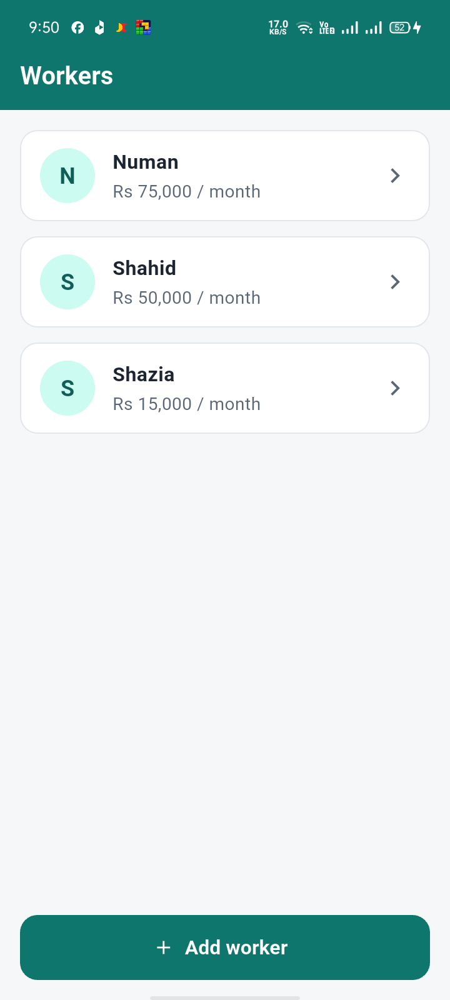
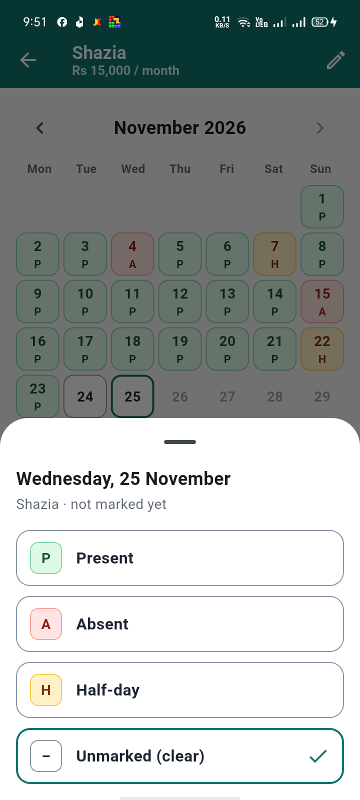
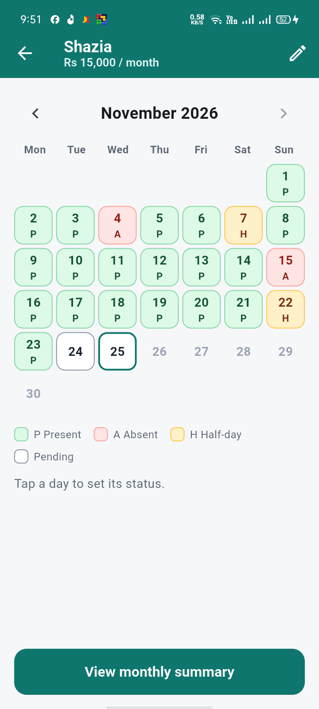
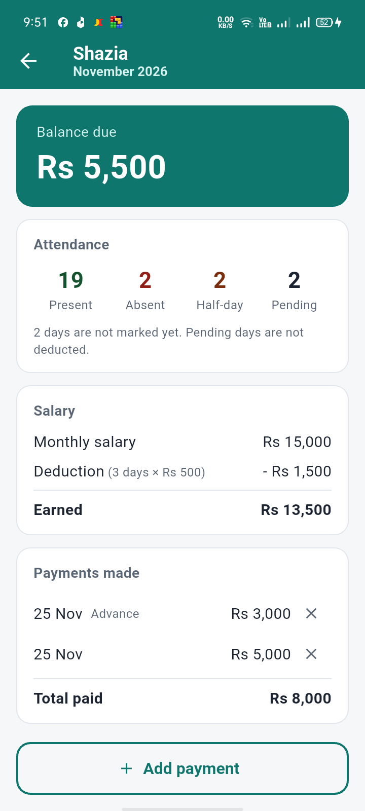
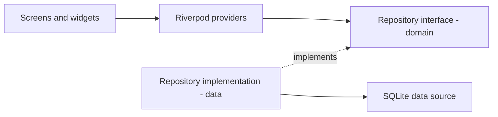

# Helper Attendance

A Flutter app to track the daily attendance and salary of household helpers (maid, cook, driver). It replaces paper notes and month-end arguments with a simple record that works fully offline.

| Workers | Attendance | Day picker | Summary |
|---|---|---|---|
|  |  |  |  |

## Features

- Add, edit and delete workers (name and monthly salary)
- Mark each day as present, absent or half-day. Unmarked days stay pending.
- Monthly summary: attendance counts, earned salary, payments made and balance due
- Record payments and advances, with an optional note
- All data stays on the phone (SQLite). No account, no internet.

## Salary rules

| Rule | Detail |
|---|---|
| Daily rate | monthly salary ÷ 30, fixed for every month |
| Deduction | daily rate × (absent days + 0.5 × half-days) |
| Pending days | not marked yet, never deducted |
| Earned | salary − deduction (never below 0) |
| Balance due | earned − payments made in that month |

Example: salary Rs 15,000 (Rs 500 a day), 2 absent and 2 half-days → deduction Rs 1,500, earned Rs 13,500. Payments of Rs 3,000 and Rs 5,000 → balance due Rs 5,500.

## Architecture

Feature-first clean architecture with Riverpod.

```
lib/
  core/        database setup, theme, shared utilities
  features/
    workers/     domain/  data/  presentation/
    attendance/  domain/  data/  presentation/
    payments/    domain/  data/  presentation/
    summary/     domain/          presentation/
```



- **domain** is plain Dart: entities, repository interfaces and the salary calculation. It knows nothing about Flutter or SQLite.
- **data** holds the models (`toMap`/`fromMap`), SQLite data sources and repository implementations.
- **presentation** holds screens, widgets and Riverpod providers.

Decisions worth knowing:

- The monthly summary is never stored. It is calculated from attendance and payments, so it cannot go out of sync. Its provider watches those two, so it updates by itself.
- Only absent, half-day and present days are saved. An unmarked day has no row.
- Use cases are only used where there is real logic (`CalculateMonthlySummary`). Plain create/read/update/delete goes straight through repositories.
- Screens depend on repository interfaces, so widget tests run against in-memory fakes with no database.
- Dates are stored as `YYYY-MM-DD` text, which sorts correctly and makes month queries simple.

## Tech stack

Flutter · Riverpod · sqflite · path

## Getting started

```
git clone <your-repo-url>
cd helper_attendance
flutter pub get
flutter run
```

Run the tests:

```
flutter test
```

Tests cover the salary calculation (including edge cases), date and money formatting, and widget tests for the workers, attendance and summary screens.

## Known limitations

- Changing a worker's salary also changes the calculation for past months, because there is no salary history.
- Pending days are never deducted, so a forgotten absence means the worker is paid for that day. The summary shows how many days are still unmarked.
- Payments count in the month of their date. Balances do not carry over to the next month.
- One household, no backup or export, English only.
- Android and iOS only (sqflite does not support web or desktop).

## Roadmap

- Salary history, so raises apply from a given month
- Carry-forward of unpaid balance
- Shareable monthly salary slip (PDF or WhatsApp)
- Backup and restore
- Urdu translation

## Author

Built by Mehbob Ul Hassan as a Flutter learning and portfolio project.
